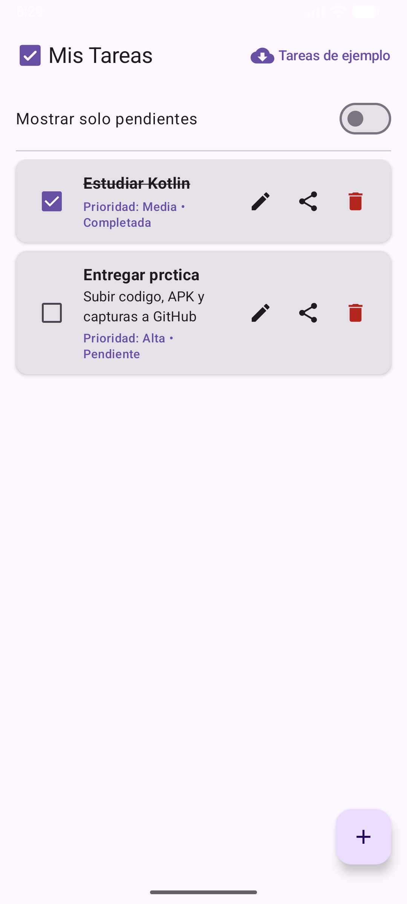
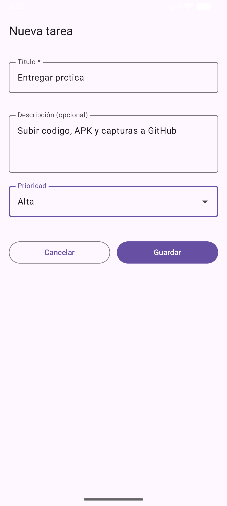
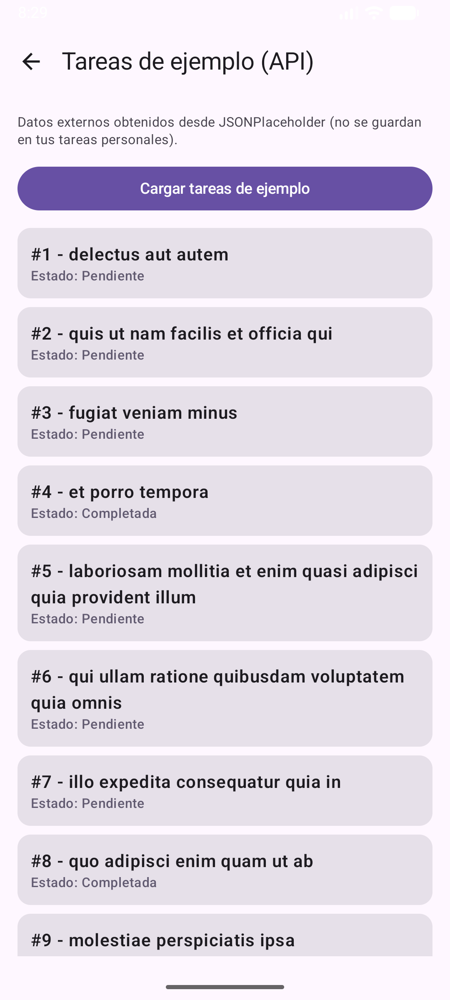
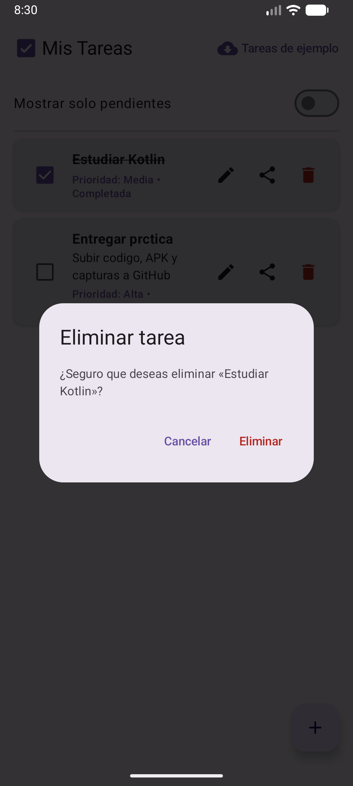

# Gestor Personal de Tareas

Aplicación Android desarrollada con Kotlin y Jetpack Compose para gestionar tareas personales, académicas o profesionales con persistencia local y consulta a servicios web.

## Funcionalidades implementadas
- Listado de tareas personales mediante `LazyColumn` con estado e indicadores de prioridad.
- Creación y edición de tareas con validación de formulario y prevención de duplicados.
- Marcado de tareas como completadas y eliminación con confirmación (`AlertDialog`).
- Persistencia permanente mediante Room y guardado del filtro *«Mostrar solo pendientes»* con Preferences DataStore.
- Consulta de tareas de ejemplo desde JSONPlaceholder usando Retrofit y coroutines, con gestión de carga y errores.
- Compartir tareas mediante `Intent.ACTION_SEND`.

## Organización del proyecto
- `model/`: Clases de datos (`Tarea`, `Prioridad`, `TareaApi`).
- `database/`: Entidad, DAO y configuración de Room (`TareaDao`, `AppDatabase`).
- `preferences/`: Gestión de preferencias con DataStore (`PreferenciasDataStore`).
- `network/`: Cliente HTTP y endpoints de Retrofit (`RetrofitClient`).
- `ui/`: Pantallas en Jetpack Compose (`ListaTareasScreen`, `FormularioTareaScreen`, `TareasEjemploScreen`).

## Bibliotecas utilizadas
- Jetpack Compose y Material 3
- Room (`room-runtime`, `room-ktx`)
- Preferences DataStore (`datastore-preferences`)
- Retrofit + Gson (`retrofit`, `converter-gson`)
- Kotlin Coroutines

## Instrucciones de ejecución
1. Clonar este repositorio y abrirlo en Android Studio.
2. Esperar a que Gradle sincronice las dependencias.
3. Ejecutar en un emulador o dispositivo físico con Android 8.0 (API 26) o superior, o instalar directamente el archivo `apk/app-debug.apk`.

## Emuladores utilizados
- **Perfil compacto**: Small Phone / Pixel 4a (1080x2340, API 34).
- **Perfil grande**: Medium Tablet (2560x1600, API 34).

## Tabla de pruebas realizadas
| Nº | Prueba | Resultado obtenido |
|---|---|---|
| 1 | Crear una tarea válida | Correcto: se guarda en Room y aparece en la lista. |
| 2 | Intentar guardar un título vacío o < 3 letras | Correcto: muestra mensaje de error y no guarda. |
| 3 | Editar una tarea | Correcto: actualiza título, descripción y prioridad. |
| 4 | Marcar una tarea como completada | Correcto: cambia el estado y persiste en Room. |
| 5 | Cancelar una eliminación | Correcto: el diálogo se cierra y la tarea permanece. |
| 6 | Eliminar una tarea confirmando | Correcto: desaparece de la lista y de Room. |
| 7 | Cerrar y volver a abrir la aplicación | Correcto: se recuperan todas las tareas guardadas. |
| 8 | Activar el filtro y reiniciar | Correcto: DataStore conserva el estado del Switch. |
| 9 | Consultar la API con Internet | Correcto: muestra el listado de tareas de ejemplo. |
| 10 | Consultar la API sin conexión | Correcto: muestra aviso de error y botón Reintentar. |
| 11 | Compartir una tarea | Correcto: abre el selector de aplicaciones del sistema. |
| 12 | Cambiar la orientación del dispositivo | Correcto: conserva pantalla actual y datos persistidos. |

## Capturas de pantalla

## Enlace al chat de IA utilizado
- [Pega aquí el enlace compartido de este chat]

## Incidencias conocidas
- Ninguna; todas las funcionalidades obligatorias operan según lo esperado.
